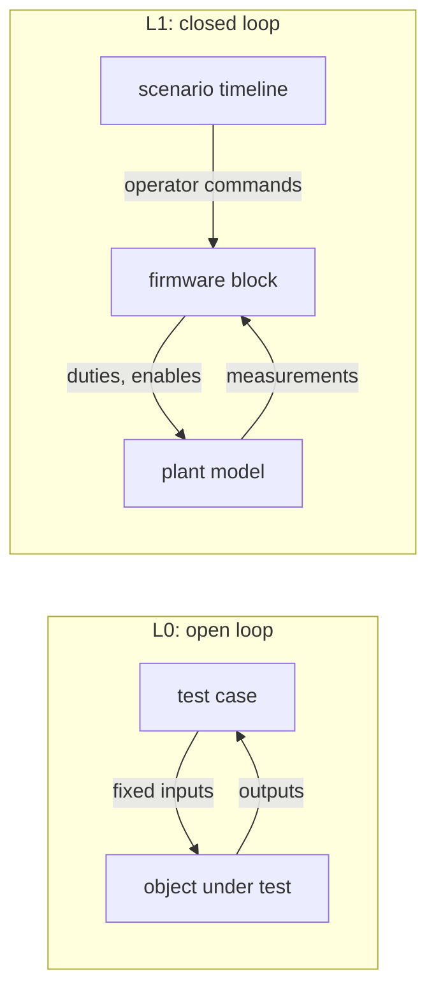
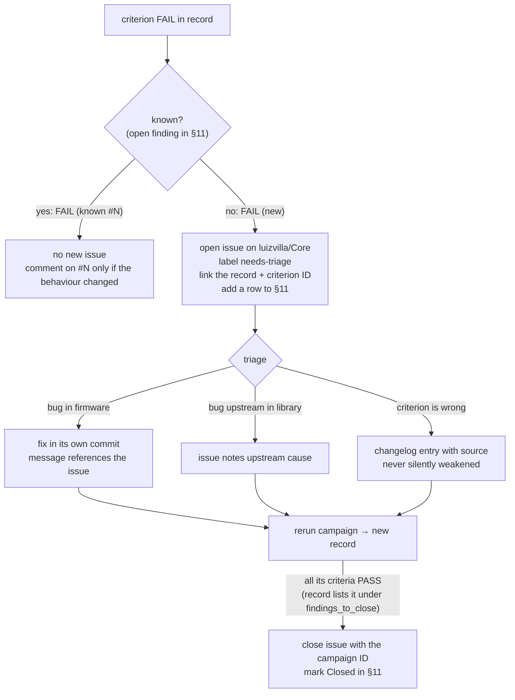
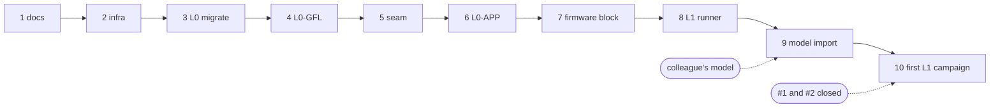

# uSolarVerter firmware test procedure

| | |
|---|---|
| Procedure version | 1.7 (draft) |
| Firmware under test | Core2 branch `test/microinverter-validation`, application in `src/` |
| Hardware target | Spin 1.2.0 + uSolarVerter 0.9.0 |
| Owner | Luiz Villa |
| Issue tracker | GitHub Issues on `luizvilla/Core` |

Terms in **bold** are defined in [GLOSSARY.md](../../GLOSSARY.md). The architecture choice for L1 is recorded in [ADR 0001](../adr/0001-firmware-in-the-loop-via-pulsim.md). Changes to production code made for testing are logged in [worklog.md](worklog.md).

---

## 1. Purpose and scope

This procedure verifies features that **already exist** in the firmware. It does not add features. A **test case** checks that the code does what its own source and documentation state.

| In scope | Out of scope |
|---|---|
| Boost converter controller (`src/boost_converter/`) | Grid-code compliance (EN 50549, VDE-AR-N 4105) |
| Grid observer (`src/grid_observer/`) | ADC scaling, sensor calibration, PWM timing, dead time |
| Grid-following inverter controller from the `single_phase_inverter` library (`jalinei/single_phase_inverter`, branch `main`, not pinned; **temporarily** `luizvilla/single_phase_inverter` branch `fix/sogi-frequency-adaptive` while finding #1 is under evaluation, see [worklog](worklog.md)) | Bench tests on hardware (L2/L3) |
| Application control logic of the critical task (`controlStep`) | Serial menu parsing, scope acquisition, telemetry printing |
| | Grid-forming controller of the same library |
| | Continuous integration |

**Pass criteria** come from values stated in the code and its documentation. Where the code states no number, the measured value is recorded with the verdict `INFO` and no limit is invented (see [§5](#5-verdicts)).

## 2. Test levels

| Level | What runs | Inputs | Plant | Tooling |
|---|---|---|---|---|
| **L0** | One object at a time, or `controlStep` | Fixed values or synthetic signals chosen by the test | None, open loop | `g++` on the host, hardware stand-in headers |
| **L1** | The **firmware block** (`controlStep` + all controllers) | Operator commands from a scenario timeline | **Plant model** in Pulsim, closed loop | Pulsim C-Block, Python |



L0 answers *"does each object do what its code claims for chosen inputs?"*. L1 answers *"does it still behave when its outputs change its own inputs?"*: dynamics, stability and interactions between the boost, the DC bus, the PLL and the observer.

### 2.1 Plant model

The plant model is provided by a colleague working in Pulsim and is imported into `tests/l1/plant/`. The user-selected plant remains switching throughout; no averaged plant is planned. Derived fixtures retain the reviewed power circuit and declare their loads and initial conditions:

| Variant | Use | Status |
|---|---|---|
| **Switched plant model** | Short windows: current-loop ripple, burst pause/resume, a few grid cycles | Switched import and integration checks implemented; formal cases still gated |

Every parameter in the model cites its source (schematic, datasheet or measurement). Missing parameters are marked `TBD`, and test cases that depend on them report `BLOCKED`.

> **Relay.** The uSolarVerter 0.9.0 board definition has no grid relay, and the application never connects to the grid. The library already exposes a relay interface: `isGridConnectionRequested()` (close request) and `setGridConnected(bool)` (feedback). If the plant model includes a relay, the connection lifecycle can be tested end to end through the L1-GFL cases. Until then those cases are `BLOCKED`.

### 2.2 Firmware block

The control logic of `loop_critical_task` is extracted into a hardware-free function (the **control step**):

```cpp
int8_t controlInit(ControlState&);
ControlOutputs controlStep(ControlState&, const Measurements&, const OperatorCommands&);
```

`ControlState` holds the boost, inverter and grid observer and the per-tick state; `controlInit` applies the application's tuning (`app::` constants in `src/app/control_step.h`). Taking the state explicitly lets each test and the L1 firmware block hold its own instance.

`main.cpp` keeps reading sensors and writing PWM through the shield API. On the host, L0 calls `controlStep` directly. For L1, `controlStep` and the controller sources are compiled into a shared library that exports the Pulsim C-Block ABI (`pulsim_cblock_step`) and runs every 100 µs. Pulsim holds the outputs (zero-order hold) between steps.

## 3. Model ↔ firmware block contract (app-v1)

> **app-v1 implemented for integration bring-up.** `tests/l1/contract.json` is the machine-readable index/actuator contract. It supersedes the initial v0 sketch for the application path. Relay lifecycle inputs belong to a future separate library-only harness; the current application has no relay command. Changes are recorded in the [changelog](#10-changelog).

All values are physical units, sampled every 100 µs (control-task period).

| Direction | Signal | Unit | Notes |
|---|---|---|---|
| Model → block | `VLow` | V | PV-side voltage |
| Model → block | `ILow1` | A | Boost leg 1 current |
| Model → block | `ILow2` | A | Boost leg 2 current |
| Model → block | `VDCBus` | V | Shared DC bus |
| Model → block | `VAC` | V | Instantaneous grid voltage |
| Model → block | `IAC` | A | Instantaneous bridge current |
| Fixture → block | `vac_updated` | 0/1 | Maps to `Measurements::v_ac_updated`; wrapper holds last delivered VAC when false |
| Scenario → block | `mode` | 0–3 | IDLE, STARTUP, BUSREG, MPPT |
| Scenario → block | `sync_request` | 0/1 | Serial command `c` |
| Scenario → block | `v_bus_ref` | V | Serial commands `u` / `d` |
| Block → model | `duty_leg1`, `duty_leg2` | 0–1 | Boost leg duties |
| Block → model | `en_leg1`, `en_leg2` | 0/1 | Boost leg PWM enables |
| Block → model | `duty_bridge` | 0–1 | Inverter leg duty |
| Block → model | `en_bridge` | 0/1 | Always false in this application |
| Block → model | `boost_mode_changed` | 0/1 | Stop both boost legs on that tick before applying updates |
| Block → model | `boost_pwm_update` | 0/1 | Apply new duties/enables only when true; otherwise hold applied state |
| Block → log | `relay_requested` | 0/1 | Library diagnostic only; remains false in application tests |
| Block → log | `theta`, `w`, observer RMS, observer frequency, trip reason, inverter mode, burst paused | — | Logged, not fed back |

## 4. Test case identification

Format: `<level>-<object>-<nn>`. A criterion inside a case adds a letter: `L1-APP-02.b`.

| Code | Object |
|---|---|
| `BST` | Boost converter controller |
| `GOB` | Grid observer |
| `GFL` | Grid-following inverter controller (library) |
| `APP` | Application control step |
| `INT` | Native C-Block/model integration, separate from formal application/library criteria |

When the same criterion runs once per mode, the mode is appended: `L0-BST-07.a-startup`, `L0-BST-07.a-busreg`.

IDs are never reused. A retired case keeps its ID with status `RETIRED` in the catalogue.

## 5. Verdicts

| Verdict | Meaning | Effect on campaign |
|---|---|---|
| `PASS` | Measured value within the stated limit | — |
| `FAIL` | Measured value outside the stated limit | Campaign fails, script exits non-zero |
| `INFO` | Measured and recorded; no limit stated in the code | — |
| `BLOCKED` | Could not run (model, parameter or relay missing) | Listed at the top of the record; campaign does not fail |

A limit is added to an `INFO` criterion only through a changelog entry stating its source.

## 6. Test catalogue

The "Source" column names the symbol that states the behaviour or the limit. Symbol names are used instead of line numbers so they survive refactoring.

### 6.1 L0-BST — boost converter

| ID | Behaviour | Source | Status |
|---|---|---|---|
| L0-BST-01 | Invalid init, measurements or burst bounds never enable a leg | `BoostConverter::init`, `isLeg1Enabled`, `isLeg2Enabled` | Migrated |
| L0-BST-02 | Leg 1 takes priority up to its current limit, leg 2 takes the excess, leg 2 is cleared when its demand stops | `splitCurrentReference` | Migrated |
| L0-BST-03 | Cold-loop saturation sets the total current reference | voltage PID bounds | Migrated |
| L0-BST-04 | MPPT perturb and observe: direction, turnaround at bounds, voltage ignored | `Mppt`, `MPPT_CURRENT_STEP` = 0.1 A | Migrated |
| L0-BST-05 | STARTUP ramp starts from the measured voltage, follows the rate, does not overshoot, restarts from the measurement on re-entry | `setStartupRampRate` (class default 10 V/s); the application sets `app::startup_ramp_rate` = 200 V/s in `control_step.h` | Migrated |
| L0-BST-06 | STARTUP current ceiling; converter 2 never enabled in STARTUP | `setStartupCurrentMax`; `startup_current_max` = 1 A | Migrated |
| L0-BST-07 | Burst hysteresis: pause at ≥ upper bound, resume at ≤ lower bound, ramp frozen, no bypass, MPPT exempt | `updateBurstState`; 395 / 405 V in `main.cpp` | Migrated |

### 6.2 L0-GOB — grid observer

| ID | Behaviour | Source | Status |
|---|---|---|---|
| L0-GOB-01 | Not operable before init; invalid config rejected | `GridObserver::init`, `canOperate` | Migrated |
| L0-GOB-02 | Qualification dwell; restart on dropout; no nuisance trip when the grid is absent at startup | `qualification_time_s` = 1 s | Migrated |
| L0-GOB-03 | RMS and frequency estimates accurate on a clean grid | `getVoltageRms`, `getFrequencyHz` | Migrated |
| L0-GOB-04 | UV, OV, UF, OF trip after their delay; shorter events do not trip | 207–253 V, 47.5–52.5 Hz, 0.1 s delays in `grid_observer_config` | Migrated |
| L0-GOB-05 | Trip latches; clearing needs a full healthy interval and open-relay feedback | `clearTrip` | Migrated |
| L0-GOB-06 | Invalid measurement trips with reason `InvalidMeasurement` | `update(..., measurements_valid)` | Migrated (already covered by the original test) |

### 6.3 L0-GFL — grid-following inverter (library)

| ID | Behaviour | Source | Verdict type | Status |
|---|---|---|---|---|
| L0-GFL-01 | Init validation; invalid config latches `VSI_FAULT_INVALID_CONFIGURATION` | library README, `init` | PASS/FAIL | Implemented |
| L0-GFL-02 | PLL locks on a clean 230 V / 50 Hz grid; synchronization only never requests PWM or relay | `getSync`, `isPwmRequested` | PASS/FAIL; lock time, phase and frequency error `INFO` | Implemented |
| L0-GFL-03 | PLL tracks a 50 → 51 Hz step (20 ms mean) and synchronizes again inside the library's ±5 % frequency window | `getw`, `synchronizationAligned` (±5 % ω, \|Vq\| < 0.1 V) | PASS/FAIL; tracking time, ripple `INFO` | Implemented; .b FAIL, [#1](https://github.com/luizvilla/Core/issues/1) |
| L0-GFL-04 | Mode lifecycle OFF → SYNC → CONNECT → CONNECTED → RUN → STOPPING → DISCONNECT → OFF with feedback; 1 s connection and disconnection timeouts; connection lost; sync lost while awaiting the relay | `vsi_mode_t`, `_connection_timeout` | PASS/FAIL | Implemented |
| L0-GFL-05 | Bad grid quality blocks SYNC and trips CONNECT/CONNECTED/RUN; `clearFault` needs good quality and an open relay | `setGridQuality`, `clearFault` | PASS/FAIL | Implemented |
| L0-GFL-06 | Non-finite measurement, non-positive bus, invalid references latch a fault with 0.5 duty and PWM off; first cause kept; requests ignored until cleared | library README (faults) | PASS/FAIL | Implemented |
| L0-GFL-07 | Duty exactly 0.5 in OFF and SYNC; duty = α / (2 · V_bus) + 0.5 otherwise, unclamped | library README (`calculateDuty`) | PASS/FAIL | Implemented |
| L0-GFL-08 | Cold-start synchronization at 47.6, 49, 50, 51 and 52.4 Hz from four grid angles (5 s horizon); settled frequency estimate within ±5 % | library README (±5 % frequency window), observer window 47.5–52.5 Hz | PASS/FAIL; worst lock time and transient `INFO` | Implemented; .a, .b, .d, .e FAIL, [#1](https://github.com/luizvilla/Core/issues/1) |

### 6.4 L0-APP — application control step (no model)

| ID | Behaviour | Source | Status |
|---|---|---|---|
| L0-APP-01 | `controlInit` applies the app tuning; a mode change is flagged on its tick only and runs the cold loop on that tick; leg enables follow the controller | critical task, mode-change block | Implemented |
| L0-APP-02 | Cold loop on the change tick, then every 10th tick; a new mode change restarts the phase | `cold_loop_divider` = 10 | Implemented |
| L0-APP-03 | VAC stale for exactly 200 periods (20 ms) trips the observer with `InvalidMeasurement`; a fresh sample restarts the count; one sample missing at boot does not latch a trip | `grid_voltage_stale_ticks` = 200; `gridObserver.cpp` (no trip latched at startup) | Implemented; .c FAIL, [#2](https://github.com/luizvilla/Core/issues/2) |
| L0-APP-04 | Bridge PWM never enabled and the inverter never requests PWM or relay, in any mode, with or without a sync request | critical task, "Synchronization only" | Implemented |
| L0-APP-05 | Synchronization only after observer qualification; an observer trip removes it on the trip tick; times to qualification and sync `INFO` | `setGridQuality(grid_observer.canOperate())` | Implemented |

### 6.5 L1-APP — application with the switching plant model

| ID | Scenario | Criteria | Model | Status |
|---|---|---|---|---|
| L1-APP-01 | IDLE on a healthy grid | legs off; observer qualifies after 1 s ± 1 tick of continuously eligible estimates; PLL lock time `INFO` | switched | Implemented (.a–.b; .c INFO) |
| L1-APP-02 | STARTUP from 0 V | bus reference follows `app::startup_ramp_rate` (200 V/s); physical ILow1 ≤ 1 A at electrical steps; leg 2 never enabled | switched | Implemented first 50 ms (.a–.c); full 2 s trajectory .d pending |
| L1-APP-03 | BUSREG at 400 V | VDCBus within 395–405 V during 80–100 ms after load step at 50 ms; overshoot/current extrema `INFO` | switched | Implemented; preserve FAIL if outside band |
| L1-APP-04 | Burst cycling at light load | start paused above 405 V, legs off, resume at 395 V; subsequent rising crossing and bus dip reported separately | switched | Initial pause/release implemented; repeated cycling pending if no later upper crossing |
| L1-APP-05 | MPPT on the PV curve | settles near the maximum power point; tracking efficiency `INFO` | switched | BLOCKED (sustained MPPT fixture) |
| L1-APP-06 | Synchronization only | inverter synchronized; bridge PWM never enabled | switched | Nominal integration runs; formal verdict gated by finding #1 |
| L1-APP-07 | Grid steps out of window (UV, OV, UF, OF) | trip within 0.1 s + 1 tick; synchronization revoked | switched | Fault scenarios pending; finding #1 verdict gate |
| L1-APP-08 | VAC samples lost for more than 20 ms | trip with reason `InvalidMeasurement` after age 200 | switched | Implemented (.a) |
| L1-APP-09 | Every mode → every other mode | legs stopped on the switching tick; peak current `INFO` | switched | Switched transition scenarios pending |

The [switched DCDC results](switched-dcdc-results.md) preserve the current regulation failure, numerical refinement and remaining coverage.

### 6.6 L1-GFL — library only, through a test harness

These cases exercise library features the application does not use. They run the library through a small test-only harness, **not** through `controlStep`, so nobody reads them as application behaviour.

| ID | Scenario | Status |
|---|---|---|
| L1-GFL-01 | Connect → run (I_d step) → stop → disconnect, with relay feedback | BLOCKED (relay) |
| L1-GFL-02 | Grid fault during RUN: fault latched, PWM dropped immediately | BLOCKED (relay) |
| L1-GFL-03 | Relay never confirms closing: fault after the 1 s timeout | BLOCKED (relay) |

### 6.7 L1-INT — native firmware-block integration

These establish the execution/measurement boundary using the same Core source. They do not unblock formal L1-APP/GFL cases, override finding #1 or claim regulation performance. [Implementation and prerequisites](../../tests/l1/README.md).

| ID | Behaviour | Source | Status |
|---|---|---|---|
| L1-INT-00 | Build/runner failure before a reported criterion must fail the campaign | campaign runner | Infrastructure fallback |
| L1-INT-01 | Wrapper matches direct controlStep; independent state; invalid ABI/timing rejected | `controlStep`, app-v1 contract | Implemented (.a–.c) |
| L1-INT-02 | Pulsim actually loads native C-Block, executes once per 100 us, closes an RC loop and resets independently | `pulsim.add_c_block`, application period | Implemented (.a–.c) |
| L1-INT-03 | Refined switched model, nominal 50 Hz sync with inverter off, exact current-probe binding and tick-aligned short STARTUP at `app::startup_ramp_rate` | accepted plant, `controlStep`, `app::startup_ramp_rate` | Implemented (.a–.d) |
| L1-INT-04 | Missing VAC delivery holds last sample and invalidates at age 200; physical grid stays present | sensor hold contract, `grid_voltage_stale_ticks` | Implemented (.a–.b) |
| L1-INT-05 | Native PV passive MPP load; actual Core MPPT coupling; initial 2 ms step refinement; short-run power ratio INFO | synthetic single-diode variant | Implemented (.a–.c PASS checks, .d INFO) |
| L1-INT-07 | Lambert W panel equals the diode panel: explicit current vs implicit solution; same switched circuit loaded through the MPP at a fixed duty (10 mV / 10 mA); speed ratio INFO | `plant/pv.py` `current_lambertw`, [PV guide](pv-model-run.md#lambert-w-panel-for-long-runs) | Implemented (.a–.b; .c INFO) |

Contract **app-v1**, in `tests/l1/contract.json`, binds six physical probes plus VAC freshness and the three existing operator commands. Outputs include the stop/update action flags as well as duties/enables; relay and bridge request telemetry stays off. The wrapper is the actual Pulsim C-Block execution path. A native synthetic PV variant is implemented and checked separately by L1-INT-05. Switched startup, regulation and initial burst fixtures are implemented. Full-duration startup, sustained MPPT acceptance, repeated burst cycles and the library-only relay/RUN harness remain incomplete. Unrun criteria are explicitly BLOCKED; measured regulation failures remain FAIL. Nominal integration does not close the open library finding.

## 7. Running a campaign

```bash
tests/run_all.sh          # L0 then L1
tests/run_all.sh --l0     # L0 only (seconds)
tests/run_all.sh --l1     # L1 only
```

The script writes the **test record** to `tests/out/<YYYY-MM-DD>_<sha7>_<time>_<unique>/`, prints the results table, and exits non-zero if any criterion is `FAIL`, if a test binary dies before reporting (build error, crash, sanitizer abort), or if the campaign reports no criteria at all. The revision component includes `-dirty` when tracked or untracked source changes exist. Repeated campaigns get separate folders; earlier records are not deleted. `tests/out/` is git-ignored: L0 and L1 are deterministic, so any record can be regenerated from its commit.

| When | What to run |
|---|---|
| Before every commit on the test branch | `tests/run_all.sh --l0` |
| Before a merge, or when the plant model changes | `tests/run_all.sh` |

### 7.1 How an L0 test reports

Each L0 test is a host binary built by its `tests/l0/<object>/run.sh` through `tests/common/l0_build.sh`. It uses `tests/common/check.h`:

```cpp
{
    tc::Criterion c("L0-BST-02.a", "Leg 1 alone up to its current limit");
    c.near("ILow1 ref at 2 A", boost.getILow1Ref(), 2.0, 1e-5);
    c.check("leg 2 disabled", !boost.isLeg2Enabled());
}   // one result line per criterion, printed here
tc::info("L0-GFL-02.b", "PLL lock time", lock_time_s, "s");
return tc::finish();
```

A failing observation does not stop the test, so every criterion gets a verdict. Firmware sources are built with `-Wall -Wextra -Werror`; third-party library sources without `-Werror`. Undefined behaviour aborts the binary (UBSan), which the runner reports as a `FAIL`.

### 7.2 Environment

| Item | Requirement |
|---|---|
| C++ compiler | `g++` with C++17 and UBSan (`-fsanitize=undefined`) |
| Python | ≥ 3.10, in a `.venv` at the repo root |
| Pulsim | `pulsim==2.0.0`, GUI `pulsimgui==1.1.1`, from `tests/l1/plant/requirements.txt`; `tests/l1/setup.sh` creates the environment |
| Inverter library | Core dependency under `owntech/lib/USB/single_phase_inverter`, fetched by PlatformIO from the `lib_deps` entry in `src/app.ini` (jalinei `main`; temporarily the #1 fix branch, see worklog). L1 setup resolves `dependencies.lock.json`, or the existing explicit library override. Actual commit/source hashes are stamped. Production unpinned dependency declaration is unchanged. |

### 7.4 Studies

A **study** (`tests/l1/study.py`, files in `tests/l1/studies/`) runs many exploratory scenarios in parallel, typically overnight, and writes one review page that is updated as runs finish. Studies answer questions; they give **no PASS/FAIL**. A behaviour that deserves a verdict becomes a catalogue criterion afterwards, with limits decided in daylight, and runs in the campaign.

Study runs may use settings the campaign does not: open-loop duties, grid steps, light profiles on the Lambert W panel, a discharged PV bus. Each case states them in its `purpose` and the review page shows them in the conditions table. Launch with `tests/l1/study.sh <study>` (detached, keeps the machine awake); see [tests/l1/studies/README.md](../../tests/l1/studies/README.md) for the file format, the follow/stop commands and the cost per simulated second.

### 7.3 Test code documentation

Every test must be readable without its author. The rules below apply to all test code, current and future, and are checked in review.

| Item | Rule |
|---|---|
| Test folder | Contains a `README.md`: what is under test, how to run it, what is compiled with which flags, how the test drives the object, the criteria table, known findings with their issue links, and history |
| `tests/`, `tests/common/` | Each has a `README.md` describing layout and shared helpers |
| C/C++ file | Core license block (LGPL-2.1, SPDX line), then a Doxygen `@file` / `@brief` block whose details list the test cases in the file |
| C/C++ function, struct, constant | Doxygen `@brief`, with `@param` / `@return` where they apply; members and constants use `///<` |
| Criterion | A Doxygen `/** @test <ID>: <description> */` line right before each `tc::Criterion` or `tc::info`, so Doxygen's *Test List* page lists every criterion |
| Shell script | `##` Doxygen-style header after the shebang: SPDX line, `@file`, `@brief`, details, `@return`, `@see`, and a `@par Usage` block |
| Python script | `##` header with `@file` and `@brief`, plus a module docstring |
| Hidden constraints | Anything a reader could break without knowing (call order, shared state, tolerances chosen for exact arithmetic) is stated with `@warning` or `@note` |

This matches the Doxygen style of the Core sources (`@file`, `@brief`, `@param`, `@return`, `///<`).

## 8. Test record

Each campaign produces one Markdown file, `record.md`, plus raw data. The front-matter is machine-readable; the body is for people.

```markdown
---
campaign: 2026-11-05_4c33fb0
date: 2026-11-05T14:02:11+01:00
operator: <git user.name>
core_commit: 4c33fb0          # + "-dirty" if the tree has uncommitted changes
library_commit: 0f22378       # single_phase_inverter
plant_model: switched@<sha7>  # or "none"
contract_version: v0
toolchain: { gcc: "13.2.0", python: "3.12.3", pulsim: "2.0.0" }
levels: [L0, L1]
verdict: FAIL                 # PASS | FAIL
new_failures: 1               # FAIL not covered by an open finding (§11)
known_failures: 5             # FAIL covered by an open finding
known_findings: [#1]
findings_to_close: []         # open findings whose criteria all pass
counts: { PASS: 41, FAIL: 6, INFO: 6, BLOCKED: 12 }
---
```

### 8.1 Setup table

| Item | Value |
|---|---|
| Core commit | `4c33fb0` |
| Library commit | `0f22378` (jalinei/single_phase_inverter `main`) |
| Plant model | switched, parameters `params.yaml@<sha7>` |
| Contract | v0 |
| Control period | 100 µs (cold loop every 10 ticks) |
| Toolchain | gcc 13.2.0, Python 3.12.3, Pulsim 2.0.0 |

### 8.2 Results table

| Criterion | Description | Limit | Measured | Verdict |
|---|---|---|---|---|
| L0-GOB-04.a | UV trips after delay | 0.1 s ± 1 tick | 0.1001 s | PASS |
| L1-APP-02.b | ILow1 during STARTUP | ≤ 1 A | 1.07 A | FAIL (**new**) |
| L0-GFL-03.b | Synchronized again at 51 Hz | all observations hold | 2/2 failed | FAIL (known #1) |
| L1-APP-03.c | VDCBus overshoot | — | 2.3 V | INFO |
| L1-GFL-01 | Connection lifecycle | — | — | BLOCKED (relay) |

`BLOCKED` rows are listed first, then `FAIL`, then everything else in ID order. A `FAIL` on a criterion listed in an open finding of the [findings register](#11-findings-register) is marked *known* with its issue; any other `FAIL` is marked **new**. The campaign verdict still counts every `FAIL` (§5); the distinction only says which failures need a new issue.

### 8.3 Raw data and plots

| File | Content |
|---|---|
| `report.html` | **The review page** (§8.5): banner, one plot per plotted criterion, changes since the previous campaign, full table |
| `record.md` | The test record: setup, results, known/new failures, findings to close |
| `l0_*.log`, `l1_*.log` | One `@@` line per criterion, plus each script's own output |
| `<scenario>/control.csv` | One row per 100 µs control tick: firmware inputs and outputs |
| `<scenario>/waveforms.npz` | Electrical states at the scenario's storage period |
| `<scenario>/manifest.json` | Scenario, model and firmware identity, peaks between samples |
| `<scenario>/model.pulsim` | The exact model the scenario ran on (accepted model + fixture + firmware block); opens in PulsimGUI |
| `<scenario>/model_power.png`, `model_full.png` | Pictures of that model: power stage, and everything |
| `<scenario>/model_changes.json` | Every parameter the fixture changed (initial voltages…) and every component it added (loads, switches) |

### 8.4 Failure follow-up



Rules:

- A failing test is never weakened to make it pass. A limit changes only through a changelog entry citing its new source.
- Fixes never go into test commits.
- The issue records the campaign ID and criterion ID so the failure can be reproduced from its commit.
- Every issue opened from a test failure gets a row in the [findings register](#11-findings-register), so later campaigns recognise it. A closed finding stays in the register with status `Closed`: if its criteria fail again, the record reports a **new** failure (a regression).
- A fix in a library is tested before merge by pointing L0 at the fix branch: `SINGLE_PHASE_INVERTER_DIR=/path/to/checkout tests/run_all.sh --l0`. The record stamps that checkout's commit.

### 8.5 Reviewing a campaign

Every campaign writes `tests/out/<campaign>/report.html`. It is the **one file to open** after a run, by whoever ran it or whoever is asked to check it.

**Every test result has the same four parts.** In the report, each L1 test case (one scenario run) is a section with, in this order:

| Part | Content | Source |
|---|---|---|
| Purpose, then **1 · Test conditions and objectives** | What the test is for; plant, input source, **DC bus state at t = 0 (precharged or discharged)**, loads and when they switch, grid, operator command timeline, firmware revision and profile, simulation length and step; the criteria judged, with their limits | scenario `title`/`purpose`/`criteria`, run manifest, model snapshot |
| **2 · Model snapshot** | Picture of the power stage as run, the full picture, the exact `model.pulsim` and the command that opens it in PulsimGUI; a table of every change from the accepted model | `tests/l1/plant/snapshot.py` |
| **3 · Results** | Each criterion with its verdict, finding and measured value | result lines |
| **4 · Figures** | One plot per waveform criterion (conventions below) | `tests/l1/review_plots.json` |

The same four parts apply to any written results report (for example `switched-dcdc-results.md`) and to diagnostics posted on an issue: conditions first, so no reader has to infer how the test was set up.

The review is the same three steps every time:

| Step | Look at | Pass if |
|---|---|---|
| 1 | **Banner**: counts, new failures, known failures, findings ready to close | No new failure, or each new failure has an issue (§8.4); counts as expected |
| 2 | **Each test case, failures first**: purpose and conditions table first (initial state, loads, commands), then the figures: the judged signal (thick line) against its limits (dashed), inside the judged window (shaded), with the driving signals below | The conditions are what you expect for that test, the plot shows the same verdict as the badge, and nothing in the driving signals looks unexplained |
| 3 | **Changes since the previous campaign**: verdicts that changed, measured values that moved by more than 1 %, criteria added or not run | Each change has a known reason (a commit, a fix, a new test) |

Then sign off in the record's front matter: `reviewed: <name>, <date>, OK` or `questions: <what>`. Records are local (§7), so a campaign that supports a decision (closing a finding, a production change, a release) is also quoted by ID in the issue or commit, with its review status.

**Plot conventions**, the same in every plot so they are learnt once:

- Thick blue line: the signal the criterion judges. Thin grey line: its reference.
- Dashed lines: limits the signal must stay within. Red dots: samples outside them, inside the window.
- Dash-dot lines: thresholds the signal crosses (burst levels); they are not limits.
- Shaded band: the time window the criterion judges. Dotted vertical lines: scenario events (load step, sample loss).
- Panels below: what drives the signal, one unit per panel (A, duty, flags). Never two units on one axis.
- The caption states where each limit and window comes from (the scenario's `acceptance` block or `tests/l1/review_plots.json`).

**Which criteria get a plot.** Those listed in `tests/l1/review_plots.json`: the L1 criteria whose verdict is read from a waveform. L0 criteria and L1 checks without a waveform stay table rows. A new L1 criterion with a waveform gets an entry in the same commit as its test; its limits must match the test's own.

Diagnostics written for a finding (`tests/l1/diagnostics/`) use the same conventions, and the issue links their plots instead of tables.

## 9. Commit plan

On branch `test/microinverter-validation` (from `dts_uverter`), pushed to `luizvilla/Core`.

| # | Commit | Delivers | Production code touched |
|---|---|---|---|
| 1 | `docs(test)` | This procedure, glossary, ADR 0001, worklog, contract v0 | No |
| 2 | `test(infra)` | `tests/common/` (CHECK helper, hardware stand-ins, record writer), `tests/run_all.sh`, `tests/out/` ignored | No |
| 3 | `test(l0)` | Move boost and observer tests to `tests/l0/`, convert to CHECK IDs; add L0-GOB-06 | No |
| 4 | `test(l0)` | L0-GFL cases | No |
| 5 | `refactor(app)` | Extract `controlStep` into `src/app/`; worklog entry | **Yes** |
| 6 | `test(l0)` | L0-APP cases | No |
| 7 | `test(l1)` | Implemented: native firmware block build, pinned environment, direct-reference and RC checks | No |
| 8 | `test(l1)` | Implemented integration runner and explicit formal-case BLOCKED reporting | No |
| 9 | `test(l1)` | Switched model and app-v1 boundary implemented; switching-only fixtures selected by user | No |
| gate | — | Findings [#1](https://github.com/luizvilla/Core/issues/1) and [#2](https://github.com/luizvilla/Core/issues/2) closed. Without #1, L1-APP-06 and -07 cannot be judged; without #2, L1-APP-01 and -08 are only valid when VAC is delivered from the first tick | #1: no (library); #2: yes (firmware) |
| 10 | `test(l1)` | Implement switched L1-APP criteria and preserve measured failures; full-duration cases remain explicit | No |
| later | `test(l1)` | Complete long startup, repeated L1-APP-04 cycles and remaining scenarios; relay + L1-GFL-* | No |



## 10. Changelog

| Version | Date | Change |
|---|---|---|
| 0.1 | 2026-11-05 | First draft: scope, levels, contract v0, catalogue, record format, commit plan |
| 0.2 | 2026-11-05 | L0-BST and L0-GOB migrated to per-criterion checks, no assertion removed. L0-GOB-06 was already covered by the original test. Criteria added to existing cases where the original test checked more than the catalogue listed: L0-GOB-04.e (opposite excursions), 04.f (negative frequency, first cause kept), 04.g (zero delays). Mode suffix for per-mode criteria. |
| 0.3 | 2026-11-05 | L0-GFL implemented. Off-nominal frequency criteria use a 20 ms mean of the PLL estimate, because the estimate carries a 100 Hz ripple away from 50 Hz. L0-GFL-03 split into frequency tracking (.a) and re-synchronization (.b). |
| 0.4 | 2026-11-05 | §7.3 test code documentation rules: README per test folder, Core license and Doxygen style in C/C++, `@test` tag per criterion, `##` Doxygen headers in shell and Python. Applied to all existing test code. L0-GFL-03.b failure filed as luizvilla/Core#1. |
| 0.5 | 2026-11-05 | Control step extracted to `src/app/control_step.{h,cpp}` with `controlInit` and an explicit `ControlState` (worklog entry of the same date). |
| 0.6 | 2026-11-05 | L0-APP implemented against `controlStep` with the application's real tuning and real-time grid delays. |
| 0.7 | 2026-11-05 | L0-GFL-08 added (cold-start synchronization across the frequency window), after an experimental fix for #1 synchronized on a 51 Hz step but diverged on a 49 Hz cold start, which L0-GFL-03 does not cover. §11 findings register; records mark known and new failures and findings ready to close. Gate on #1 before commit 10. `SINGLE_PHASE_INVERTER_DIR` tests a library branch before merge. |
| 0.8 | 2026-11-05 | Implement native `controlStep` C-Block/RC/switched-model integration (L1-INT-01–04), app-v1 manifest, GUI view and explicit unmet-prerequisite reporting. Import the refined switched model; averaged/PV and library-only connection fixtures remain pending. Keep the default 10 V/s Core profile and finding #1 gate. Source identity wording clarified in ADR 0001. Repeated campaigns retain independent records. No production controller/application code changed. |
| 0.9 | 2026-11-05 | Implement synthetic native single-diode PV variant, wired bus test load, precharged fixture, independent MPP reference, PV diagnostics, GUI saved-result loading and L1-INT-05. Formal L1-APP-05 remains pending sustained tracking acceptance; short-run extraction is below available MPP. No controller tuning changed. |
| 1.0 | 2026-11-05 | User selects switching model only; remove averaged-model prerequisite. Implement formal nominal-grid, lost-VAC, first-50-ms startup, precharged bus regulation/load step and initial burst release criteria. Specify observation windows and partial-run limits; preserve measured failures. Keep production firmware unchanged and expose scenario fixtures/results through the GUI. |
| 1.1 | 2026-11-05 | `src/app.ini` temporarily fetches the #1 fix branch (worklog). Records stamp the library's remote and branch, not only its commit. |
| 1.2 | 2026-11-05 | L0-APP-03.c added (boot with a missing first VAC sample), exposed by the earlier L1-FWB-01 prototype; fails, filed as #2 and registered in §11. |
| 1.3 | 2026-11-05 | Branch `test/microinverter-validation-v2`: Jean Alinei's switched L1 work adopted as the L1 implementation (user decision); the earlier L1-FWB-01 prototype and its contract v1 are retired, superseded by L1-INT-01/-02 and contract app-v1. Archived results removed from git: records stay local and are regenerated from their commit (§7). Switched plant only, no averaged variant ([ADR 0002](../adr/0002-switched-plant-only.md)). Production `app::startup_ramp_rate` raised from 10 to 200 V/s at Jean's request (worklog); L1 limits read it from `control_step.h`; full startup is now 2 s. L1-APP-03.a FAIL filed as #3 (§11). |
| 1.4 | 2026-11-05 | §8.5 review routine: every campaign writes `report.html` (banner, one plot per waveform criterion with limits and window drawn, changes since the previous campaign, full table), defined by `tests/l1/review_plots.json`; sign-off line in the record. §8.3 lists the files a campaign actually writes. |
| 1.5 | 2026-11-05 | §8.5: every test result has four parts (purpose + conditions and objectives, model snapshot, results, figures); the review page is organised per test case. Scenarios carry `title`, `purpose` and `criteria`. Each scenario folder keeps the exact model it ran on, its pictures and its changes from the accepted model (§8.3). The contract profile name follows the 200 V/s change (`Core-app-default-200Vps-sync-only`). |
| 1.6 | 2026-11-06 | Lambert W panel (`pv_model: lambertw`) for long PV runs, about 4.5× faster than the diode panel, which also fails to converge under heavy load; validated by L1-INT-07 in every campaign. Scenarios may carry a `light` profile (irradiance over time, Lambert W panel only). Review plots can read electrical traces and compare with a reference run (difference panel). |
| 1.7 | 2026-11-06 | §7.4 studies: exploratory parallel runs with no verdicts, launched detached overnight, one review page updated as runs finish (summary of every case, then the four parts). Runner options for studies: grid steps, open-loop duty, discharged PV bus. |

## 11. Findings register

Every issue opened from a test failure, with what it blocks. `tests/common/make_record.py` reads this table: a `FAIL` on a criterion listed in an **open** row is reported as *known* with its issue; a finding whose criteria all pass is listed as ready to close. Keep the column order; a case ID (`L0-GFL-08`) covers all its criteria. Set the status to `Closed (<campaign ID>)` when the issue is closed, and keep the row.

| Issue | Criteria | Cause | Owner | Status | Blocks |
|---|---|---|---|---|---|
| [#1](https://github.com/luizvilla/Core/issues/1) | L0-GFL-03.b, L0-GFL-08 | Library: SOGI evaluated at the fixed ω_ref, so the 2ω ripple on Vq exceeds the 0.1 V sync tolerance away from 50 Hz | Jean (library) | Open: fix proposed (jalinei/single_phase_inverter#1); firmware temporarily built against it | Gate before commit 10 (L1-APP-06, -07) |
| [#2](https://github.com/luizvilla/Core/issues/2) | L0-APP-03.c | Firmware: VAC staleness counter starts stale, the observer trips `InvalidMeasurement` before qualification, and the app never calls `clearTrip()`, so one missing VAC sample at boot blocks synchronization until reset | Luiz (firmware) | Open: needs triage | Gate before commit 10 (L1-APP-01, -06, -08) |
| [#3](https://github.com/luizvilla/Core/issues/3) | L1-APP-03.a | Bus sags to 368–377 V after the 50 ms load step while both current references are at their 1 A limit with duties of only 0.22/0.11 and ±18 A physical current swings; PWM mapping (H1) and current sampling (H2) ruled out as the cause; the converter delivers under 1 W while the duty climbs slowly from 0.05 | Luiz | Open: H3 done. The plant needs duty ≈ 0.40 before any power flows (gain ≈ 6·VLow/(1−d)); the current loop restarts at 0.05 on every mode change and gains about 0.003/ms, so it takes over 100 ms to get there. Firmware decision pending | None (DC/DC regulation evidence only) |
