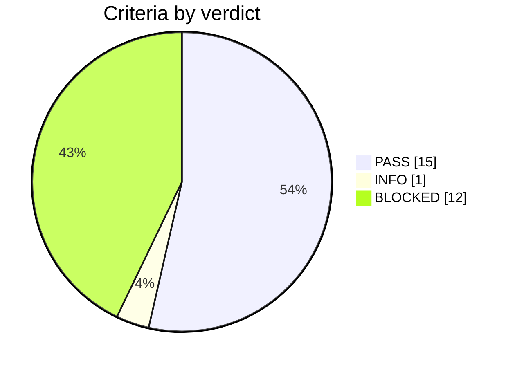

# Test record 2026-11-05_28f7f0f-dirty_175316_E42pwh

**Campaign verdict: PASS**: 15 pass, 0 fail, 1 info, 12 blocked, over 17 test cases.

> **L1 scope:** integration bring-up only. Formal L1 catalogue cases remain BLOCKED; averaged-model, sustained MPPT, burst and library-only connection prerequisites remain pending. The synthetic PV variant has separate integration evidence.

> **Blocked:** L1-APP-01, L1-APP-02, L1-APP-03, L1-APP-04, L1-APP-05, L1-APP-06, L1-APP-07, L1-APP-08, L1-APP-09, L1-GFL-01, L1-GFL-02, L1-GFL-03. See the results table for the reason.

## Setup

| Item | Value |
|---|---|
| Core commit | `28f7f0f-dirty` |
| Library commit | `0f22378` (single_phase_inverter, jalinei `main`) |
| Plant model | switched full_model.pulsim@58839236cbd5 (integration bring-up) |
| Contract | app-v1 |
| Control period | 100 µs (cold loop every 10 ticks) |
| Toolchain | gcc 13.3.0, Python 3.12.3, Pulsim 2.0.0 |
| Host | Linux 7.0.0-42-generic x86_64 |
| Levels run | L1 |

## Verdicts

## Test cases

| Test case | Criteria | Verdict |
|---|---|---|
| L1-APP-01 | 1 | BLOCKED |
| L1-APP-02 | 1 | BLOCKED |
| L1-APP-03 | 1 | BLOCKED |
| L1-APP-04 | 1 | BLOCKED |
| L1-APP-05 | 1 | BLOCKED |
| L1-APP-06 | 1 | BLOCKED |
| L1-APP-07 | 1 | BLOCKED |
| L1-APP-08 | 1 | BLOCKED |
| L1-APP-09 | 1 | BLOCKED |
| L1-GFL-01 | 1 | BLOCKED |
| L1-GFL-02 | 1 | BLOCKED |
| L1-GFL-03 | 1 | BLOCKED |
| L1-INT-01 | 3 | PASS |
| L1-INT-02 | 3 | PASS |
| L1-INT-03 | 4 | PASS |
| L1-INT-04 | 2 | PASS |
| L1-INT-05 | 4 | PASS |

## Results

| Criterion | Description | Limit | Measured | Verdict |
|---|---|---|---|---|
| L1-APP-01 | Formal catalogue prerequisite | — | averaged model unavailable; observer qualification timing criterion needs clarification | BLOCKED |
| L1-APP-02 | Formal catalogue prerequisite | — | averaged model unavailable; production 10 V/s baseline retained; physical-current/reference criterion unresolved | BLOCKED |
| L1-APP-03 | Formal catalogue prerequisite | — | averaged model unavailable; regulation observation window not specified | BLOCKED |
| L1-APP-04 | Formal catalogue prerequisite | — | validated switched operating-point/controller-state fixture not provided | BLOCKED |
| L1-APP-05 | Formal catalogue prerequisite | — | native PV variant implemented; sustained MPPT fixture and declared settling/acceptance window pending; short-run extraction remains far below available MPP | BLOCKED |
| L1-APP-06 | Formal catalogue prerequisite | — | procedure gate: open finding #1 and averaged model unavailable | BLOCKED |
| L1-APP-07 | Formal catalogue prerequisite | — | procedure gate: open finding #1; phase-continuous fault scenarios/averaged model pending | BLOCKED |
| L1-APP-08 | Formal catalogue prerequisite | — | formal averaged-model fixture pending; stale-delivery integration is covered separately by L1-INT-04 | BLOCKED |
| L1-APP-09 | Formal catalogue prerequisite | — | formal mode-transition fixture/averaged model pending | BLOCKED |
| L1-GFL-01 | Formal catalogue prerequisite | — | library-only connection harness and validated relay fixture pending; application remains synchronization-only | BLOCKED |
| L1-GFL-02 | Formal catalogue prerequisite | — | library-only RUN/fault harness pending | BLOCKED |
| L1-GFL-03 | Formal catalogue prerequisite | — | library-only relay timeout harness pending | BLOCKED |
| L1-INT-01.a | Native ABI matches direct controlStep, including mode changes and held VAC | abs error ≤ 0 | 2/2 ok, max abs error 0 | PASS |
| L1-INT-01.b | Independent C-Block contexts start fresh | all observations hold | 1/1 ok | PASS |
| L1-INT-01.c | Invalid ABI and skipped ticks report block_error | all observations hold | 2/2 ok | PASS |
| L1-INT-02.a | Pulsim schedules real native controlStep once per 100 us | all observations hold | 31 | PASS |
| L1-INT-02.b | Native C-Block drives RC and reads its changing bus voltage | all observations hold | 0.03597534618136537 | PASS |
| L1-INT-02.c | Repeated new model/block starts identically | all observations hold | 31 | PASS |
| L1-INT-03.a | Refined switched model runs actual Core C-Block at the declared period | all observations hold | 13001 | PASS |
| L1-INT-03.b | Nominal 50 Hz integration qualifies and synchronizes with bridge and relay off | all observations hold | 1.1309 | PASS |
| L1-INT-03.c | Physical current probe inputs retain native current offsets | all observations hold | 3.9549828676817036e-10 | PASS |
| L1-INT-03.d | Tick-aligned STARTUP uses unchanged 10 V/s Core profile | all observations hold | [(0.001, 0.009999999776482582)] | PASS |
| L1-INT-04.a | VAC delivery dropout triggers Core stale detection after exactly 200 periods | all observations hold | 0.0299 | PASS |
| L1-INT-04.b | Sample-loss fixture does not switch off the physical grid | all observations hold | 650.5382386916237 | PASS |
| L1-INT-05.a | Native PV source and passive load match independent MPP | observations hold | 38.463592501705186 | PASS |
| L1-INT-05.b | PV switched model executes actual Core MPPT, with bridge and relay off | observations hold | 21 | PASS |
| L1-INT-05.c | 50/25 ns PV integration agrees within 0.1 V over the initial 2 ms | observations hold | {'pv_voltage': 0.034792436123673554, 'VDCBus': 0.0027836787240289596} | PASS |
| L1-INT-05.d | Short PV run mean delivered power / available MPP (not settled acceptance) | observations hold | 0.013056343170403618 | INFO |

## Raw data

| File | Content |
|---|---|
| `l1_l1.log` | Full output of `l1_l1` |
| `l1-manifest.json` | Plant/profile/contract/toolchain identity |
| `firmware-manifest.json` | Exact Core/dependency sources and native C-Block hash |
| `contract.json` | Inputs, outputs and hardware-adapter assumptions |
| `idle_healthy/` | Scenario manifest, control.csv and waveforms.npz |
| `pv-25ns/` | Scenario manifest, control.csv and waveforms.npz |
| `pv-50ns/` | Scenario manifest, control.csv and waveforms.npz |
| `startup_short/` | Scenario manifest, control.csv and waveforms.npz |
| `vac_dropout/` | Scenario manifest, control.csv and waveforms.npz |
