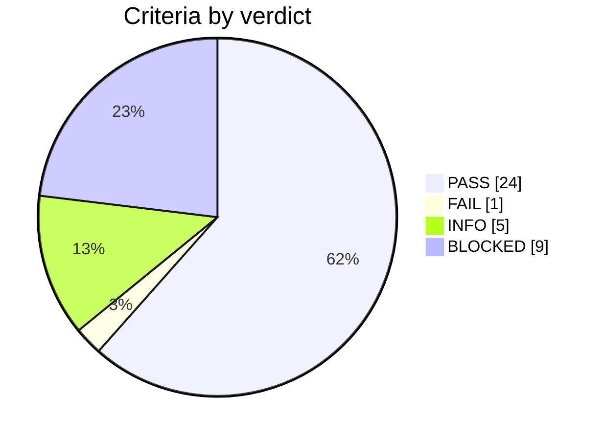

# Test record 2026-11-05_28f7f0f-dirty_181727_1IftGG

**Campaign verdict: FAIL**: 24 pass, 1 fail, 5 info, 9 blocked, over 17 test cases.

> **Failures:** 1 new, 0 known (open findings, procedure §11). Only new failures need an issue.

> **L1 scope:** switching integration plus selected formal application criteria. First-50-ms startup, declared-window regulation and initial burst release are assessed. Full startup, repeated burst cycles and remaining scenarios are explicitly incomplete. No averaged model is required.

> **Blocked:** L1-APP-02, L1-APP-04, L1-APP-05, L1-APP-06, L1-APP-07, L1-APP-09, L1-GFL-01, L1-GFL-02, L1-GFL-03. See the results table for the reason.

## Setup

| Item | Value |
|---|---|
| Core commit | `28f7f0f-dirty` |
| Library commit | `0f22378` (single_phase_inverter, jalinei `main`) |
| Plant model | switched full_model.pulsim@58839236cbd5 (switching integration + selected application criteria) |
| Contract | app-v1 |
| Control period | 100 µs (cold loop every 10 ticks) |
| Toolchain | gcc 13.3.0, Python 3.12.3, Pulsim 2.0.0 |
| Host | Linux 7.0.0-42-generic x86_64 |
| Levels run | L1 |

## Verdicts

## Test cases

| Test case | Criteria | Verdict |
|---|---|---|
| L1-APP-01 | 3 | PASS |
| L1-APP-02 | 4 | BLOCKED |
| L1-APP-03 | 3 | FAIL |
| L1-APP-04 | 5 | BLOCKED |
| L1-APP-05 | 1 | BLOCKED |
| L1-APP-06 | 1 | BLOCKED |
| L1-APP-07 | 1 | BLOCKED |
| L1-APP-08 | 1 | PASS |
| L1-APP-09 | 1 | BLOCKED |
| L1-GFL-01 | 1 | BLOCKED |
| L1-GFL-02 | 1 | BLOCKED |
| L1-GFL-03 | 1 | BLOCKED |
| L1-INT-01 | 3 | PASS |
| L1-INT-02 | 3 | PASS |
| L1-INT-03 | 4 | PASS |
| L1-INT-04 | 2 | PASS |
| L1-INT-05 | 4 | PASS |

## Results

| Criterion | Description | Limit | Measured | Verdict |
|---|---|---|---|---|
| L1-APP-02.d | Full zero-to-400 V startup trajectory | complete 40 s switched run | Only first 50 ms executed; no full-ramp claim | BLOCKED |
| L1-APP-04.d | Subsequent rising upper-threshold crossing | pause at >= 405 V | No subsequent 405 V crossing in 150 ms; repeated burst cycle not established | BLOCKED |
| L1-APP-05 | Formal catalogue prerequisite | — | native PV variant implemented; sustained MPPT fixture and declared settling/acceptance window pending; short-run extraction remains far below available MPP | BLOCKED |
| L1-APP-06 | Formal catalogue prerequisite | — | procedure verdict gate: open finding #1; nominal integration runs regardless | BLOCKED |
| L1-APP-07 | Formal catalogue prerequisite | — | procedure verdict gate: open finding #1; switched phase-continuous fault scenarios pending | BLOCKED |
| L1-APP-09 | Formal catalogue prerequisite | — | formal switched mode-transition fixture pending | BLOCKED |
| L1-GFL-01 | Formal catalogue prerequisite | — | library-only connection harness and validated relay fixture pending; application remains synchronization-only | BLOCKED |
| L1-GFL-02 | Formal catalogue prerequisite | — | library-only RUN/fault harness pending | BLOCKED |
| L1-GFL-03 | Formal catalogue prerequisite | — | library-only relay timeout harness pending | BLOCKED |
| L1-APP-03.a | BUSREG after 50 ms load step, assessed over 80-100 ms | 395-405 V | (367.67322422947393, 376.94479291709206) | FAIL (**new**) |
| L1-APP-01.a | IDLE on a healthy switched grid keeps boost legs disabled | both off | 13001 | PASS |
| L1-APP-01.b | Observer qualifies after continuous healthy estimated grid | 1 s +/- 100 us | 1.0001 | PASS |
| L1-APP-01.c | Time from electrical start to PLL synchronization | informational | 1.1309 | INFO |
| L1-APP-02.a | STARTUP reference ramp over first 50 ms | 10 V/s, 1e-4 V numerical tolerance | 2.086162567138672e-07 | PASS |
| L1-APP-02.b | STARTUP physical leg-1 current over first 50 ms | <= 1 A at every 50 ns step | 0.6047010979912011 | PASS |
| L1-APP-02.c | STARTUP keeps converter 2 disabled | always off | 0.0 | PASS |
| L1-APP-03.b | Maximum bus overshoot above 400 V | informational | 0.0 | INFO |
| L1-APP-03.c | Physical current extrema including initial conditions | informational | {'ILow1': {'min': -13.768654350837176, 'max': 17.918261208763578}, 'ILow2': {'min': -13.792139690784094, 'max': 17.95722455995066}} | INFO |
| L1-APP-04.a | Burst fixture starts paused above upper threshold | pause for Vbus >= 405 V | 406.0 | PASS |
| L1-APP-04.b | Both boost legs remain disabled while burst-paused | both off | 317 | PASS |
| L1-APP-04.c | Burst releases when electrical bus reaches lower threshold | Vbus <= 395 V | [(0.0317, 394.9835720837511)] | PASS |
| L1-APP-04.e | Minimum bus during burst fixture | informational | 358.48153286779785 | INFO |
| L1-APP-08.a | Lost VAC samples trigger InvalidMeasurement | 200 control periods | 0.0299 | PASS |
| L1-INT-01.a | Native ABI matches direct controlStep, including mode changes and held VAC | abs error ≤ 0 | 2/2 ok, max abs error 0 | PASS |
| L1-INT-01.b | Independent C-Block contexts start fresh | all observations hold | 1/1 ok | PASS |
| L1-INT-01.c | Invalid ABI and skipped ticks report block_error | all observations hold | 2/2 ok | PASS |
| L1-INT-02.a | Pulsim schedules real native controlStep once per 100 us | all observations hold | 31 | PASS |
| L1-INT-02.b | Native C-Block drives RC and reads its changing bus voltage | all observations hold | 0.03597534618136537 | PASS |
| L1-INT-02.c | Repeated new model/block starts identically | all observations hold | 31 | PASS |
| L1-INT-03.a | Refined switched model runs actual Core C-Block at the declared period | all observations hold | 13001 | PASS |
| L1-INT-03.b | Nominal 50 Hz integration qualifies and synchronizes with bridge and relay off | all observations hold | 1.1309 | PASS |
| L1-INT-03.c | Physical current probe inputs retain native current offsets | all observations hold | 3.9549828676817036e-10 | PASS |
| L1-INT-03.d | Tick-aligned STARTUP uses unchanged 10 V/s Core profile | all observations hold | [(0.001, 0.009999999776482582)] | PASS |
| L1-INT-04.a | VAC delivery dropout triggers Core stale detection after exactly 200 periods | all observations hold | 0.0299 | PASS |
| L1-INT-04.b | Sample-loss fixture does not switch off the physical grid | all observations hold | 650.5382386916237 | PASS |
| L1-INT-05.a | Native PV source and passive load match independent MPP | observations hold | 38.463592501705186 | PASS |
| L1-INT-05.b | PV switched model executes actual Core MPPT, with bridge and relay off | observations hold | 21 | PASS |
| L1-INT-05.c | 50/25 ns PV integration agrees within 0.1 V over the initial 2 ms | observations hold | {'pv_voltage': 0.034792436123673554, 'VDCBus': 0.0027836787240289596} | PASS |
| L1-INT-05.d | Short PV run mean delivered power / available MPP (not settled acceptance) | observations hold | 0.013056343170403618 | INFO |

## Raw data

| File | Content |
|---|---|
| `l1_l1.log` | Full output of `l1_l1` |
| `l1-manifest.json` | Plant/profile/contract/toolchain identity |
| `firmware-manifest.json` | Exact Core/dependency sources and native C-Block hash |
| `contract.json` | Inputs, outputs and hardware-adapter assumptions |
| `dcdc_burst/` | Scenario manifest, control.csv and waveforms.npz |
| `dcdc_busreg/` | Scenario manifest, control.csv and waveforms.npz |
| `dcdc_startup/` | Scenario manifest, control.csv and waveforms.npz |
| `idle_healthy/` | Scenario manifest, control.csv and waveforms.npz |
| `pv-25ns/` | Scenario manifest, control.csv and waveforms.npz |
| `pv-50ns/` | Scenario manifest, control.csv and waveforms.npz |
| `startup_short/` | Scenario manifest, control.csv and waveforms.npz |
| `vac_dropout/` | Scenario manifest, control.csv and waveforms.npz |

## Follow-up

New failures: L1-APP-03.a.

Open one issue per failing test case on `luizvilla/Core` with the `needs-triage` label, quoting this campaign ID and the criterion IDs, then add it to the findings register (procedure §8.4, §11). Known failures already have an issue: comment there only if the behaviour changed.
