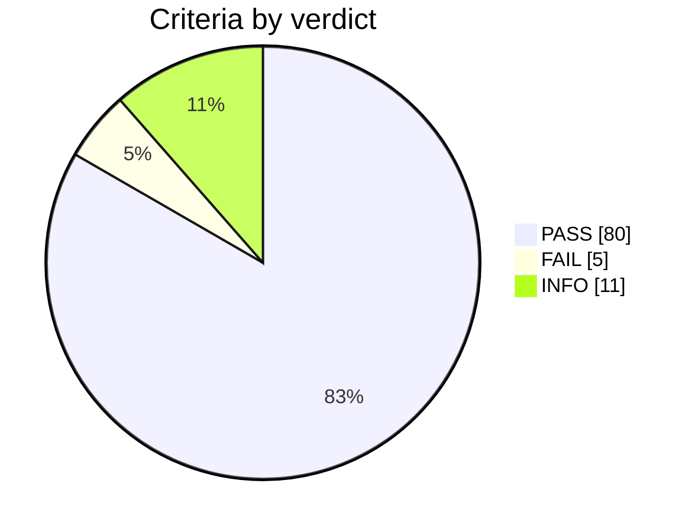

# Test record 2026-11-05_28f7f0f

**Campaign verdict: FAIL**: 80 pass, 5 fail, 11 info, 0 blocked, over 26 test cases.

> **Failures:** 0 new, 5 known (open findings, procedure §11). Only new failures need an issue.

## Setup

| Item | Value |
|---|---|
| Core commit | `28f7f0f` |
| Library commit | `0f22378` (single_phase_inverter, jalinei `main`) |
| Plant model | none |
| Contract | v0 |
| Control period | 100 µs (cold loop every 10 ticks) |
| Toolchain | gcc 13.3.0, Python 3.12.3, Pulsim not installed |
| Host | Linux 7.0.0-42-generic x86_64 |
| Levels run | L0 |

## Verdicts

## Test cases

| Test case | Criteria | Verdict |
|---|---|---|
| L0-APP-01 | 3 | PASS |
| L0-APP-02 | 2 | PASS |
| L0-APP-03 | 2 | PASS |
| L0-APP-04 | 1 | PASS |
| L0-APP-05 | 4 | PASS |
| L0-BST-01 | 4 | PASS |
| L0-BST-02 | 3 | PASS |
| L0-BST-03 | 2 | PASS |
| L0-BST-04 | 4 | PASS |
| L0-BST-05 | 3 | PASS |
| L0-BST-06 | 3 | PASS |
| L0-BST-07 | 9 | PASS |
| L0-GFL-01 | 4 | PASS |
| L0-GFL-02 | 5 | PASS |
| L0-GFL-03 | 6 | FAIL |
| L0-GFL-04 | 5 | PASS |
| L0-GFL-05 | 3 | PASS |
| L0-GFL-06 | 4 | PASS |
| L0-GFL-07 | 2 | PASS |
| L0-GFL-08 | 7 | FAIL |
| L0-GOB-01 | 2 | PASS |
| L0-GOB-02 | 2 | PASS |
| L0-GOB-03 | 1 | PASS |
| L0-GOB-04 | 7 | PASS |
| L0-GOB-05 | 4 | PASS |
| L0-GOB-06 | 4 | PASS |

## Results

| Criterion | Description | Limit | Measured | Verdict |
|---|---|---|---|---|
| L0-GFL-03.b | Synchronized again at 51 Hz, inside the library's ±5 % frequency window (3 s horizon) | all observations hold | 2/2 failed; first: getSync() true at end | FAIL (known [#1](https://github.com/luizvilla/Core/issues/1)) |
| L0-GFL-08.a | Cold-start synchronization at 47.6 Hz from four grid angles (5 s horizon); settled estimate within ±5 % | all observations hold | 8/12 failed; first: getSync() within 5 s | FAIL (known [#1](https://github.com/luizvilla/Core/issues/1)) |
| L0-GFL-08.b | Cold-start synchronization at 49 Hz from four grid angles (5 s horizon); settled estimate within ±5 % | all observations hold | 8/12 failed; first: getSync() within 5 s | FAIL (known [#1](https://github.com/luizvilla/Core/issues/1)) |
| L0-GFL-08.d | Cold-start synchronization at 51 Hz from four grid angles (5 s horizon); settled estimate within ±5 % | all observations hold | 8/12 failed; first: getSync() within 5 s | FAIL (known [#1](https://github.com/luizvilla/Core/issues/1)) |
| L0-GFL-08.e | Cold-start synchronization at 52.4 Hz from four grid angles (5 s horizon); settled estimate within ±5 % | all observations hold | 8/12 failed; first: getSync() within 5 s | FAIL (known [#1](https://github.com/luizvilla/Core/issues/1)) |
| L0-APP-01.a | controlInit applies the application's tuning | abs error ≤ 1e-06 | 9/9 ok, max abs error 0 | PASS |
| L0-APP-01.b | A mode change is flagged on its tick only and runs the cold loop on that tick | all observations hold | 125/125 ok | PASS |
| L0-APP-01.c | Leg enables follow the boost controller; IDLE leaves the legs untouched | all observations hold | 251/251 ok | PASS |
| L0-APP-02.a | The cold loop runs on the mode-change tick, then every 10th tick | all observations hold | 202/202 ok | PASS |
| L0-APP-02.b | A new mode change restarts the cold-loop phase | all observations hold | 11/11 ok | PASS |
| L0-APP-03.a | VAC stale for 200 periods (20 ms) trips the observer with InvalidMeasurement | all observations hold | 5/5 ok | PASS |
| L0-APP-03.b | One fresh VAC sample restarts the 20 ms staleness count | all observations hold | 3/3 ok | PASS |
| L0-APP-04.a | The inverter bridge is never enabled, in any mode, with or without a sync request | all observations hold | 10/10 ok | PASS |
| L0-APP-05.a | Synchronization waits for the observer's qualification, not only for PLL alignment | all observations hold | 4/4 ok | PASS |
| L0-APP-05.b | Time from start to observer qualification | — | 1.0199 s | INFO |
| L0-APP-05.c | Time from start to inverter synchronization | — | 1.1199 s | INFO |
| L0-APP-05.d | An observer trip (200 V under-voltage) removes synchronization on the trip tick | all observations hold | 4/4 ok | PASS |
| L0-BST-01.a | Uninitialized controller outputs nothing and enables no leg | all observations hold | 5/5 ok | PASS |
| L0-BST-01.b-busreg | Invalid burst bounds are rejected and keep the configured ones (BUSREG) | abs error ≤ 1e-05 | 7/7 ok, max abs error 0 | PASS |
| L0-BST-01.b-startup | Invalid burst bounds are rejected and keep the configured ones (STARTUP) | abs error ≤ 1e-05 | 7/7 ok, max abs error 0 | PASS |
| L0-BST-01.c | Invalid measurements and configuration cannot enable a leg | abs error ≤ 1e-05 | 11/11 ok, max abs error 0 | PASS |
| L0-BST-02.a | Leg 1 alone below and at its current limit | abs error ≤ 1e-05 | 8/8 ok, max abs error 0 | PASS |
| L0-BST-02.b | Above the limit leg 1 stays at the limit and leg 2 supplies the excess | abs error ≤ 1e-05 | 9/9 ok, max abs error 0 | PASS |
| L0-BST-02.c | Removing leg 2 demand clears its output and integral before reuse | abs error ≤ 1e-05 | 4/4 ok, max abs error 0 | PASS |
| L0-BST-03.a | Cold-loop saturation sets the total reference, split across both legs | abs error ≤ 1e-05 | 20003/20003 ok, max abs error 0 | PASS |
| L0-BST-03.b | IDLE clears references and duties | all observations hold | 2/2 ok | PASS |
| L0-BST-04.a | MPPT perturbs current demand from total input power | abs error ≤ 1e-05 | 4/4 ok, max abs error 0 | PASS |
| L0-BST-04.b | MPPT restarts on reference changes, keeps leg 1 priority, turns back at bounds | abs error ≤ 1e-05 | 10/10 ok, max abs error 4.76837e-07 | PASS |
| L0-BST-04.c | MPPT ignores bus voltages and voltage PID gains; hot loop does not advance it | abs error ≤ 1e-05 | 6/6 ok, max abs error 0 | PASS |
| L0-BST-04.d | Voltage PID current bounds also constrain MPPT | abs error ≤ 1e-05 | 6/6 ok, max abs error 0 | PASS |
| L0-BST-05.a | STARTUP ramp starts from the latest bus sample and follows the rate | abs error ≤ 1e-05 | 10/10 ok, max abs error 0 | PASS |
| L0-BST-05.b | Target and rate changes continue the ramp without reset or overshoot | abs error ≤ 1e-05 | 6/6 ok, max abs error 0 | PASS |
| L0-BST-05.c | Reset and re-entry restart from the measured voltage, keeping target and rate | abs error ≤ 1e-05 | 6/6 ok, max abs error 0 | PASS |
| L0-BST-06.a | STARTUP never enables converter 2 and respects the current ceiling | abs error ≤ 1e-05 | 405/405 ok, max abs error 0 | PASS |
| L0-BST-06.b | Ceiling updates apply immediately, reject invalid values, never exceed the leg 1 limit | abs error ≤ 1e-05 | 14/14 ok, max abs error 0 | PASS |
| L0-BST-06.c | A ceiling below the PID lower bound is still respected | abs error ≤ 1e-05 | 5/5 ok, max abs error 0 | PASS |
| L0-BST-07.a-busreg | Burst pauses at the upper bound without a cold-loop call (BUSREG) | abs error ≤ 1e-05 | 29/29 ok, max abs error 0 | PASS |
| L0-BST-07.a-startup | Burst pauses at the upper bound without a cold-loop call (STARTUP) | abs error ≤ 1e-05 | 29/29 ok, max abs error 0 | PASS |
| L0-BST-07.b-busreg | Burst resumes at the lower bound; demand regenerated by the cold loop (BUSREG) | all observations hold | 5/5 ok | PASS |
| L0-BST-07.b-startup | Burst resumes at the lower bound; demand regenerated by the cold loop (STARTUP) | all observations hold | 5/5 ok | PASS |
| L0-BST-07.c-busreg | Cold loop detects overvoltage; reset and mode change cannot bypass a pause (BUSREG) | all observations hold | 5/5 ok | PASS |
| L0-BST-07.c-startup | Cold loop detects overvoltage; reset and mode change cannot bypass a pause (STARTUP) | all observations hold | 5/5 ok | PASS |
| L0-BST-07.d-busreg | Bounds persist across init; MPPT and IDLE are exempt from burst (BUSREG) | all observations hold | 7/7 ok | PASS |
| L0-BST-07.d-startup | Bounds persist across init; MPPT and IDLE are exempt from burst (STARTUP) | all observations hold | 7/7 ok | PASS |
| L0-BST-07.e | Configuring bounds while active pauses immediately with no PI windup kept | abs error ≤ 1e-05 | 5/5 ok, max abs error 0 | PASS |
| L0-GFL-01.a | Valid init starts in OFF with no fault, no PWM and no relay request | abs error ≤ 0.001 | 6/6 ok, max abs error 0 | PASS |
| L0-GFL-01.b | Invalid init parameters return -EINVAL and latch INVALID_CONFIGURATION | all observations hold | 40/40 ok | PASS |
| L0-GFL-01.c | A successful init after an invalid one clears the fault | all observations hold | 4/4 ok | PASS |
| L0-GFL-01.d | calculateDuty before init latches INVALID_CONFIGURATION with neutral duty | all observations hold | 3/3 ok | PASS |
| L0-GFL-02.a | PLL synchronizes on a clean 230 V / 50 Hz grid (5 s horizon) | abs error ≤ 2.5 | 5/5 ok, max abs error 0.00255872 | PASS |
| L0-GFL-02.b | Synchronization only never requests PWM or relay closure | all observations hold | 2/2 ok | PASS |
| L0-GFL-02.c | Time to getSync() true from a 1 rad phase offset (includes 1000-call dwell) | — | 0.1882 s | INFO |
| L0-GFL-02.d | Steady-state phase error after 5 s | — | 1.80246 deg | INFO |
| L0-GFL-02.e | Steady-state frequency error after 5 s | — | -0.00255872 Hz | INFO |
| L0-GFL-03.a | PLL frequency estimate follows a 50 → 51 Hz step (3 s horizon) | abs error ≤ 2.5 | 1/1 ok, max abs error 0.00626831 | PASS |
| L0-GFL-03.c | Time until the 20 ms mean estimate stays within 51 ± 0.05 Hz | — | 0.0439 s | INFO |
| L0-GFL-03.d | Time not synchronized after the step (of 3 s) | — | 2.9999 s | INFO |
| L0-GFL-03.e | Steady-state error of the 20 ms mean estimate at 51 Hz | — | 0.00626831 Hz | INFO |
| L0-GFL-03.f | Peak  Vq  ripple at 51 Hz (sync tolerance 0.1 V) | — | 3.26793 V | INFO |
| L0-GFL-04.a | Lifecycle OFF → SYNC → CONNECT → CONNECTED → RUN → CONNECTED → STOPPING → DISCONNECT → OFF | all observations hold | 16/16 ok | PASS |
| L0-GFL-04.b | Relay never confirms closing: CONNECTION_TIMEOUT after 1 s | abs error ≤ 0.0002 | 5/5 ok, max abs error 0 | PASS |
| L0-GFL-04.c | Relay never confirms opening: DISCONNECTION_TIMEOUT 1 s after the disconnect request | abs error ≤ 0.0002 | 4/4 ok, max abs error 0 | PASS |
| L0-GFL-04.d | Relay feedback lost in RUN: GRID_CONNECTION_LOST, PWM dropped | all observations hold | 6/6 ok | PASS |
| L0-GFL-04.e | Grid phase jump while awaiting the relay: SYNC_LOST | all observations hold | 4/4 ok | PASS |
| L0-GFL-05.a | Bad grid quality blocks synchronization; good quality restarts the 1000-call dwell | all observations hold | 6/6 ok | PASS |
| L0-GFL-05.b | Bad grid quality in CONNECT, CONNECTED or RUN trips BAD_GRID_QUALITY at once | all observations hold | 19/19 ok | PASS |
| L0-GFL-05.c | clearFault needs good grid quality and an open relay, then returns to OFF | all observations hold | 8/8 ok | PASS |
| L0-GFL-06.a | Non-finite measurements latch INVALID_MEASUREMENT with neutral duty and no PWM | all observations hold | 14/14 ok | PASS |
| L0-GFL-06.b | Non-positive bus voltage latches INVALID_BUS_VOLTAGE | all observations hold | 7/7 ok | PASS |
| L0-GFL-06.c | Non-finite current reference or invalid frequency reference latches INVALID_REFERENCE | all observations hold | 12/12 ok | PASS |
| L0-GFL-06.d | A latched fault keeps its first cause and ignores requests until cleared | all observations hold | 8/8 ok | PASS |
| L0-GFL-07.a | Duty is exactly 0.5 in OFF and VOLTAGE_SYNC | all observations hold | 5101/5101 ok | PASS |
| L0-GFL-07.b | Duty = alpha_output / (2 V_bus) + 0.5 every sample, unclamped | abs error ≤ 1e-06 | 603/603 ok, max abs error 0 | PASS |
| L0-GFL-08.c | Cold-start synchronization at 50 Hz from four grid angles (5 s horizon); settled estimate within ±5 % | all observations hold | 12/12 ok | PASS |
| L0-GFL-08.f | Worst cold-start time to synchronization over the cases that locked | — | 0.1964 s | INFO |
| L0-GFL-08.g | Worst transient error of the 20 ms mean frequency estimate during cold start | — | 24.6549 Hz | INFO |
| L0-GOB-01.a | Not operable before init | all observations hold | 4/4 ok | PASS |
| L0-GOB-01.b | Invalid configurations are rejected and leave the observer inoperable | all observations hold | 18/18 ok | PASS |
| L0-GOB-02.a | Missing grid at startup blocks operation without a nuisance trip | all observations hold | 101/101 ok | PASS |
| L0-GOB-02.b | Qualification dwell restarts on a dropout | all observations hold | 14/14 ok | PASS |
| L0-GOB-03.a | RMS voltage and frequency estimates on a clean 230 V / 50 Hz grid | abs error ≤ 0.001 | 300/300 ok, max abs error 3.05176e-05 | PASS |
| L0-GOB-04.a | UV (200 V) trips after its delay; a shorter event does not | all observations hold | 17/17 ok | PASS |
| L0-GOB-04.b | OV (260 V) trips after its delay; a shorter event does not | all observations hold | 17/17 ok | PASS |
| L0-GOB-04.c | UF (45 Hz) trips after its delay; a shorter event does not | all observations hold | 19/19 ok | PASS |
| L0-GOB-04.d | OF (55 Hz) trips after its delay; a shorter event does not | all observations hold | 19/19 ok | PASS |
| L0-GOB-04.e | Opposite voltage excursions do not accumulate into one timer | all observations hold | 20/20 ok | PASS |
| L0-GOB-04.f | Negative frequency trips as under-frequency; the first cause is kept | all observations hold | 11/11 ok | PASS |
| L0-GOB-04.g | Zero qualification time and zero delay act on the first sample | all observations hold | 3/3 ok | PASS |
| L0-GOB-05.a | UV (200 V) trip latches; clearing needs a healthy interval and open relay | all observations hold | 12/12 ok | PASS |
| L0-GOB-05.b | OV (260 V) trip latches; clearing needs a healthy interval and open relay | all observations hold | 12/12 ok | PASS |
| L0-GOB-05.c | UF (45 Hz) trip latches; clearing needs a healthy interval and open relay | all observations hold | 12/12 ok | PASS |
| L0-GOB-05.d | OF (55 Hz) trip latches; clearing needs a healthy interval and open relay | all observations hold | 12/12 ok | PASS |
| L0-GOB-06.a | Invalid measurement (NaN alpha) trips at once; recovery qualification restarts on a dropout | all observations hold | 22/22 ok | PASS |
| L0-GOB-06.b | Invalid measurement (infinite beta) trips at once; recovery qualification restarts on a dropout | all observations hold | 22/22 ok | PASS |
| L0-GOB-06.c | Invalid measurement (NaN frequency) trips at once; recovery qualification restarts on a dropout | all observations hold | 22/22 ok | PASS |
| L0-GOB-06.d | Invalid measurement (validity flag false) trips at once; recovery qualification restarts on a dropout | all observations hold | 22/22 ok | PASS |

## Raw data

| File | Content |
|---|---|
| `l0_app.log` | Full output of `l0_app` |
| `l0_boost.log` | Full output of `l0_boost` |
| `l0_grid_observer.log` | Full output of `l0_grid_observer` |
| `l0_inverter_following.log` | Full output of `l0_inverter_following` |
